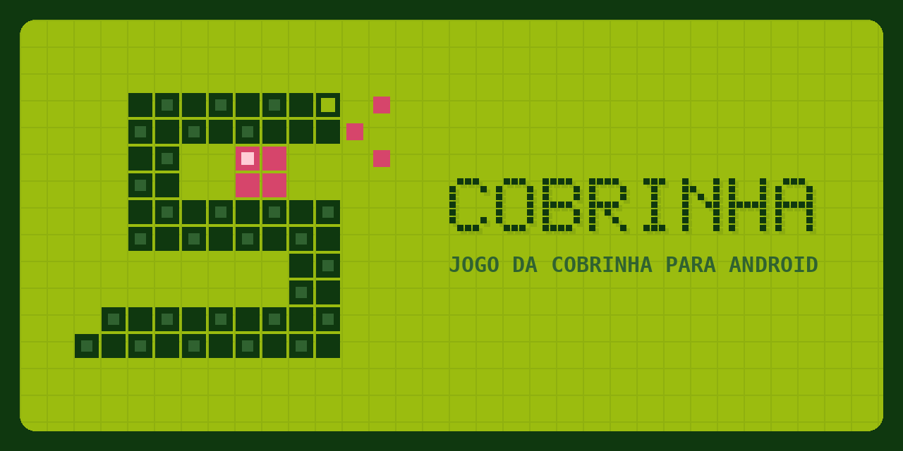

# Cobrinha



Jogo da cobrinha para Android feito com Expo (React Native + TypeScript), com visual de console portátil: tela LCD verde, D-pad e botões A/B.

## Controles

| Controle | Ação |
| --- | --- |
| D-pad (ou deslizar no LCD) | Muda a direção |
| A / START | Jogar, pausar e continuar |
| B / SELECT | Pausa durante o jogo; fora dele, começa uma partida nova |

O recorde fica salvo no aparelho. O jogo pausa sozinho se o app for para segundo plano.

## Rodar

```bash
npm install
npx expo start
```

Abra o QR code no Expo Go (Android). Os anúncios só funcionam no APK ou em um development build.

## APK

- **Build local (GitHub Actions):** o workflow `Android APK (build local)` roda a cada push na `main` e publica o artefato `cobrinha-apk`. O APK sai assinado com a chave debug do template, então serve para instalar e testar.
- **EAS Build:** workflow `EAS Build (Android)` (manual). Requer o secret `EXPO_TOKEN` no repositório.

## Anúncios (AdMob)

Anúncio intersticial ao reiniciar depois de perder, no máximo a cada 3 partidas e com intervalo mínimo de 90 s. Nunca aparece no meio do jogo.

Por padrão o app usa os **IDs de teste** do Google. Para usar os seus, crie as variáveis em *Settings > Secrets and variables > Actions > Variables*:

| Variável | Valor |
| --- | --- |
| `ADMOB_ANDROID_APP_ID` | App ID do Android (`ca-app-pub-...~...`) |
| `ADMOB_INTERSTITIAL_ANDROID` | ID do bloco de anúncio intersticial (`ca-app-pub-.../...`) |

Localmente, use `ADMOB_ANDROID_APP_ID` e `EXPO_PUBLIC_ADMOB_INTERSTITIAL_ANDROID` no ambiente. O módulo é nativo: não funciona no Expo Go (o jogo roda normal, só sem anúncios); use o APK ou um development build.

Não clique nos seus próprios anúncios reais para testar: isso pode suspender a conta do AdMob.

## Identidade visual

Paleta LCD de 4 tons (`#0F380F`, `#306230`, `#8BAC0F`, `#9BBC0F`) com a maçã em `#D6456B`. Os ícones, a splash e as imagens da loja (`store/`) são gerados por script:

```bash
python3 scripts/generate-assets.py   # requer Pillow
```

## Estrutura

- `App.tsx`: tela, loop do jogo e entrada (D-pad, botões, swipe)
- `src/game/logic.ts`: regras do jogo (funções puras)
- `src/components/`: tabuleiro LCD e controles do console
- `src/theme.ts`: cores
